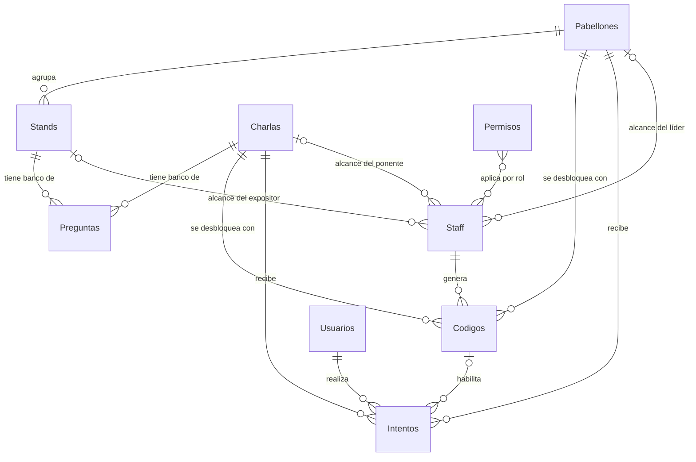

# Modelo de datos

Última actualización: 2026-10-13 (versión del código `2026-10-13.1`)

Todos los datos viven en un único archivo de Google Sheets con 11 hojas. El ranking no es una hoja: se calcula desde `Intentos`.

**Se responde una unidad.** Una unidad es un **pabellón** (cada uno de sus stands aporta unas pocas preguntas de su banco) o una **charla** (un solo banco). El intento, el código, el índice por persona y el puntaje van por unidad, con un `unidad_id` que vale `PAB-001`, `CHA-001`, etc. Los stands ya no se responden uno a uno: son los bancos de preguntas del pabellón.

## Hojas

| Hoja | Tipo | Para qué |
|---|---|---|
| `Pabellones` | Catálogo | Agrupador de stands. Es una unidad del quiz: se responde el pabellón entero, con código o sin él (el quiz de entrada) |
| `Stands` | Catálogo | Agente dentro de un pabellón. Aporta su banco de preguntas al quiz del pabellón |
| `Charlas` | Catálogo | Charlas y talleres previos al evento, con su horario. Cada una es una unidad con su propio banco (opcional; solo hace falta para la semana de charlas) |
| `Preguntas` | Catálogo | Banco de preguntas por stand y por charla |
| `Staff` | Catálogo | Líderes de pabellón, expositores de stand, ponentes de charla, validadores y administradores |
| `Permisos` | Catálogo | Vistas de la app disponibles para cada rol |
| `Config` | Catálogo | Parámetros de la aplicación |
| `Premios` | Catálogo | Premios que se muestran en la sala de espera (opcional) |
| `Usuarios` | Transaccional | Personas que entraron a la app: las que responden quizzes y las que pasaron por la sala de espera |
| `Codigos` | Transaccional | Códigos temporales por pabellón y por charla |
| `Intentos` | Transaccional | Participaciones y puntaje |

Las hojas de catálogo casi no cambian durante la feria y se editan desde el panel admin. Dos excepciones: un expositor (o un ponente) con la vista `PREGUNTAS` edita las preguntas de su banco, y la pantalla de ranking guarda sus ajustes en `Config`. Las transaccionales las escribe la aplicación mientras la feria está en curso.

La app busca cada hoja y cada columna por su nombre, sin distinguir mayúsculas, tildes ni espacios sobrantes. El orden de las columnas no importa, con una condición: la columna A debe tener siempre dato, porque las filas con la columna A vacía se ignoran.

## Relación entre las tablas

`Config` y `Premios` no se relacionan con ninguna hoja.

### Detalle de cada relación

| Desde | Campo | Hacia | Cardinalidad | Obligatoria | Nota |
|---|---|---|---|---|---|
| `Stands` | `pabellon_id` | `Pabellones.pabellon_id` | Muchos a uno | Sí | Todo stand pertenece a un pabellón |
| `Preguntas` | `stand_id` | `Stands.stand_id` o `Charlas.charla_id` | Muchos a uno | Sí | Cada pregunta es de un solo banco: un stand o una charla. La columna se llama `stand_id` y lleva el ID de la charla cuando es de una charla |
| `Codigos` | `unidad_id` | `Pabellones.pabellon_id` o `Charlas.charla_id` | Muchos a uno | Sí | Un código desbloquea un solo pabellón o una sola charla |
| `Codigos` | `generado_por` | `Staff.email` | Muchos a uno | Sí | Líder o admin que generó el código |
| `Intentos` | `email` | `Usuarios.email` | Muchos a uno | Sí | Quién responde. La fila de `Usuarios` existe antes que el intento: su `orden` decide en qué filas se escribe |
| `Intentos` | `unidad_id` | `Pabellones.pabellon_id` o `Charlas.charla_id` | Muchos a uno | Sí | Qué pabellón o charla responde |
| `Intentos` | `pabellon_id` | `Pabellones.pabellon_id` | Muchos a uno | No | Copia de `unidad_id` cuando es un pabellón; vacío en las charlas |
| `Intentos` | `codigo` | `Codigos.codigo` | Muchos a uno | No | Vacío en el quiz de entrada |
| `Intentos` | `preguntas_json` | `Preguntas.pregunta_id` | Muchos a muchos | Sí | Lista de IDs sorteados, guardada como JSON |
| `Staff` | `pabellon_id` | `Pabellones.pabellon_id` | Muchos a uno | No | El líder (su pabellón) y el expositor (el pabellón de su stand). Vacío para los demás roles |
| `Staff` | `stand_id` | `Stands.stand_id` | Muchos a uno | No | Solo el expositor: su stand, que debe pertenecer a su pabellón |
| `Staff` | `charla_id` | `Charlas.charla_id` | Muchos a uno | No | Solo el ponente: su charla |
| `Staff` | `rol` | `Permisos.rol` | Muchos a muchos | Sí | Se une por el texto del rol; un rol tiene varias filas en `Permisos` |

### Reglas de integridad

Google Sheets no valida relaciones; estas reglas las hace cumplir el Apps Script.

1. **Un intento por persona y unidad:** la app no crea un segundo intento para el mismo `email` y `unidad_id` (un pabellón o una charla). Si aun así quedara una fila repetida, el ranking cuenta solo la primera y `auditarPuntajes` la lista.
2. **Las claves no se reutilizan ni se derivan del nombre:** pabellones, stands, charlas y preguntas usan correlativos generados (`PAB-001`, `STD-001`, `CHA-001`, `PRG-001`); el último número usado queda guardado aparte, así que borrar una fila no libera su clave. Los intentos usan `INT-` y 12 caracteres al azar. Renombrar un stand no rompe sus preguntas ni sus intentos.
3. **Baja desde el panel:** stands, charlas, preguntas, staff, permisos y premios se desactivan (`activo = FALSE`); la fila queda. Un parámetro de `Config` se borra y la app vuelve a su valor por defecto. Eliminar un pabellón borra físicamente el pabellón, sus stands y sus preguntas, anula su código activo y conserva los intentos históricos.
4. **Bajas que el panel no permite:** desactivar un stand o una charla con preguntas activas, desactivar el propio acceso de administrador y dejar a `ADMIN` sin un permiso `PANEL_ADMIN` activo.
5. **Coherencia de `pabellon_id` en `Intentos`:** cuando la unidad es un pabellón, `pabellon_id` es igual a `unidad_id`; en una charla va vacío.
6. **Coherencia del código:** un código solo abre el pabellón o la charla para el que se generó.
7. **Preguntas del intento:** todos los IDs de `preguntas_json` son preguntas activas de los bancos de la unidad del intento al momento de crearlo: en un pabellón, `preguntas_por_stand` de cada uno de sus stands; en una charla, `preguntas_quiz` de su banco.
8. **Un código activo por unidad:** cada pabellón con código y cada charla tienen una sola fila en `Codigos` y al generar uno nuevo reemplaza al anterior. Un código nuevo no repite el anterior de la unidad ni ninguno activo de otra (si dos generaciones simultáneas eligieran el mismo, no hay efecto: el código solo abre la unidad que se elige en la app). `ANULADO` aparece cuando el admin elimina un pabellón (se anula su código activo) y, junto con `EXPIRADO`, en filas repetidas de una unidad (datos de antes o de una simulación) que la generación deja de lado.
9. **Banco suficiente:** el quiz de un pabellón se abre cuando **cada** uno de sus stands activos tiene al menos 10 activas (constante `PREGUNTAS_BANCO_STAND` en el código, no se lee de Config), y el de una charla cuando su banco tiene al menos 15 (`preguntas_banco` de la charla, o `preguntas_banco_charla`). 10 y 15 también son el tope de preguntas activas que un expositor o un ponente puede tener: una pregunta nueva que pasa del tope se rechaza con un mensaje. El admin no tiene ese tope. El servidor sortea `preguntas_por_stand` (2) de cada stand, o `preguntas_quiz` (5) de la charla, y solo esas viajan al celular. Con 4 stands el quiz del pabellón es de 8 preguntas.
10. **El quiz de entrada es un pabellón sin código:** es el pabellón activo con `requiere_codigo = FALSE`. En el catálogo inicial es `PAB-000`, con un solo stand (`STD-000`) y `preguntas_por_stand = 4`, así que sortea 4 preguntas. Solo puede haber uno: el panel no deja guardar un segundo.
11. **Pabellones del mapa:** aparecen los pabellones activos que piden código y tienen al menos un stand activo. Por eso el pabellón del quiz de entrada no se muestra. Los stands se ven dentro del pabellón solo como información.
12. **El quiz de entrada va primero:** el servidor no deja empezar un pabellón con código hasta que el quiz de entrada esté respondido o vencido. Las charlas no lo piden.
13. **Un permiso por rol y vista:** la combinación `rol` + `vista` es única en `Permisos`.
14. **Roles válidos:** todo `rol` usado en una fila activa de `Staff` debe tener al menos una fila activa en `Permisos`. `USUARIO` no hace falta escribirlo en `Staff`: es el rol de quien no aparece ahí.
15. **`QUIZ` necesita `MAPA` o `CHARLAS`:** el quiz se abre desde el mapa (pabellones) o desde la agenda de charlas, así que el panel no deja activar `QUIZ` para un rol que no tenga una de las dos. El servidor además exige `MAPA` para abrir un pabellón y `CHARLAS` para abrir una charla.
16. **Los permisos no reemplazan la validación del servidor:** `Permisos` decide qué vistas se muestran, pero cada función del Apps Script vuelve a comprobar el permiso antes de ejecutar.
17. **Un número de orden por persona, sin repetir:** cada persona tiene un `orden` distinto y una sola fila en `Usuarios`, la de su número (la persona 1 en la fila 2). Lo entrega el registro por lotes con el turno global y no se reutiliza aunque se borre la fila.
18. **Cada intento, en el bloque de su persona:** la fila de un intento en `Intentos` está dentro de las 16 filas que le corresponden al `orden` de su `email`. En un bloque hay filas de una sola persona. Antes de escribir, la app comprueba que todo lo que hay en el bloque lleve el correo de quien escribe.
19. **Responsable desde el formulario:** el formulario de un pabellón maneja un solo **líder** (`LIDER`, `pabellon_id`), el de un stand un solo **expositor** (`EXPOSITOR`, `pabellon_id` y `stand_id`) y el de una charla un solo **ponente** (`PONENTE`, `charla_id`). En cada caso es la primera fila activa de `Staff` con ese rol y esa ID. Cambiar el correo da de alta al nuevo y desactiva al anterior (la fila queda); vaciarlo desactiva al responsable; si el correo ya tiene una fila inactiva de ese rol, se reactiva con esta ubicación y conserva su nombre. El servidor rechaza, antes de escribir, un correo que ya está en `Staff` con otro rol (para no degradar a un `ADMIN`), que ya responde de otra cosa, o un pabellón sin código, o un registro inactivo. Si el stand cambia de pabellón, su expositor lo sigue. Otros responsables de lo mismo escritos a mano en `Staff` no se tocan.
20. **Un rol, una cosa:** una persona tiene una sola fila en `Staff` y un solo rol. El líder trabaja sobre un pabellón (ignora `stand_id`), el expositor sobre un stand y el ponente sobre una charla; cada función del servidor comprueba el rol además de la vista. Quien lidere o exponga en más de un lugar necesita otro correo.
21. **Disponibilidad por permisos:** durante la semana de charlas el `USUARIO` tiene las vistas `CHARLAS` y `QUIZ`; durante el evento, `MAPA` y `QUIZ`. El admin lo cambia en `Permisos`. Mientras `espera_activa` esté en TRUE el usuario solo ve la sala de espera, así que debe estar en FALSE.
22. **Cierre de una charla:** la columna `cierre` de `Charlas` es la hora límite para empezar el quiz y para que el ponente genere códigos; el servidor lo comprueba (motivo `CIERRE`) y no lo salva un código vigente. Quien ya tiene su quiz en curso lo termina. El admin puede generar un código después del cierre. Solo aplica a charlas: los pabellones no cierran. Sin `cierre`, la charla no cierra nunca.

## Campos por hoja

Las columnas `descripcion`, `nombre_corto`, `preguntas_por_stand` y `creado_en` son opcionales: la app funciona sin ellas. `probarTodo` comprueba que existan todas las demás.

### `Pabellones`

| Campo | Tipo | Ejemplo | Nota |
|---|---|---|---|
| `pabellon_id` | Texto | `PAB-001` | Clave. La genera el panel |
| `nombre` | Texto | Fábricas de servicios y backend | Visible en la hoja del pabellón |
| `nombre_corto` | Texto | Backend | Opcional. Es el rótulo del mapa; si está vacío o la columna no existe se usa `nombre` |
| `descripcion` | Texto | Descubre agentes de IA para… | Opcional. Se muestra bajo el título de la tarjeta del pabellón en la sala de espera; si está vacía no se muestra |
| `requiere_codigo` | Booleano | TRUE | FALSE solo en el quiz de entrada. Si la celda está vacía (o no hay columna) se deduce de los stands, como antes del quiz por pabellón |
| `preguntas_por_stand` | Número | 2 | Opcional. Cuántas preguntas aporta cada stand al quiz del pabellón; vacío = `preguntas_por_stand` de `Config`. El quiz de entrada lleva 4 |
| `orden` | Número | 1 | Orden en la app. Entero, cero o más |
| `activo` | Booleano | TRUE | Baja lógica |
| `creado_en` | Fecha/hora | | Opcional. La app no lo llena ni lo lee |

### `Stands`

| Campo | Tipo | Ejemplo | Nota |
|---|---|---|---|
| `stand_id` | Texto | `STD-001` | Clave. La genera el panel |
| `pabellon_id` | Texto | `PAB-001` | Referencia a un pabellón activo |
| `nombre` | Texto | APX | Visible para el usuario |
| `descripcion` | Texto | | Opcional. Solo se ve en el panel |
| `orden` | Número | 1 | Orden dentro del pabellón |
| `activo` | Booleano | TRUE | Baja lógica |
| `creado_en` | Fecha/hora | | Opcional. La app no lo llena ni lo lee |

### `Charlas`

Hoja opcional: solo hace falta para la semana de charlas. Cada fila es una charla; las fechas se escriben en la hoja, no en el código.

| Campo | Tipo | Ejemplo | Nota |
|---|---|---|---|
| `charla_id` | Texto | `CHA-001` | Clave. La genera el panel |
| `titulo` | Texto | Introducción a los custom agents | Visible en la agenda de charlas |
| `ponente` | Texto | Rosa Quiroz | Opcional. Nombre que ve la gente; el correo del ponente va en `Staff` |
| `descripcion` | Texto | | Opcional |
| `inicio` | Fecha/hora | `2026-10-19 10:00` | Desde esta hora la charla se puede responder si hay un código vigente. Se interpreta en la zona horaria del script (`America/Lima`) |
| `fin` | Fecha/hora | `2026-10-19 11:00` | Opcional. Hora real de término de la charla; solo informativa |
| `cierre` | Fecha/hora | `2026-10-19 11:30` | Opcional. **Hora límite para responder:** hasta ahí se puede empezar el quiz y el ponente puede generar códigos (el admin sí puede después). Vacía = la charla no cierra nunca. Debe ser posterior a `inicio` |
| `preguntas_banco` | Número | 15 | Opcional. Tope del ponente y mínimo para abrir el quiz; vacío = `preguntas_banco_charla` de `Config` |
| `preguntas_quiz` | Número | 5 | Opcional. Cuántas preguntas se sortean; vacío = `preguntas_quiz_charla` de `Config` |
| `orden` | Número | 1 | Desempata charlas con la misma hora |
| `activo` | Booleano | TRUE | Baja lógica |
| `creado_en` | Fecha/hora | | Opcional |

Los puntos de cada pregunta de una charla se definen en `Preguntas.puntos` (o `puntos_por_defecto`); el tiempo para responder es `minutos_para_responder` y el código dura `minutos_vigencia_codigo`.

### `Preguntas`

| Campo | Tipo | Ejemplo | Nota |
|---|---|---|---|
| `pregunta_id` | Texto | `PRG-001` | Clave. La genera la app |
| `stand_id` | Texto | `STD-001` | Referencia a un stand activo o, si es de una charla, el ID de la charla (`CHA-001`) |
| `texto` | Texto | | Enunciado |
| `opcion_a` | Texto | | |
| `opcion_b` | Texto | | |
| `opcion_c` | Texto | | |
| `opcion_d` | Texto | | |
| `correcta` | Texto | B | A–D; nunca se envía al celular del participante |
| `puntos` | Número | 10 | Valor si acierta. Entero. Vacío o 0 vale `puntos_por_defecto` |
| `activo` | Booleano | TRUE | Baja lógica |
| `creado_en` | Fecha/hora | | Opcional. Se llena al importar un JSON o cuando la crea un expositor o un ponente; el formulario del panel no lo llena |

Un expositor (de un stand) o un ponente (de una charla) con la vista `PREGUNTAS` crea y edita el enunciado, las opciones y la correcta de las preguntas de su banco. No cambia `puntos` ni `activo`: una pregunta nueva vale `puntos_por_defecto` y nace activa. Si el banco ya tiene su tope de preguntas activas (10 en un stand, 15 en una charla), la pregunta nueva se rechaza con un mensaje; puede editar las que ya hay.

### `Staff`

| Campo | Tipo | Ejemplo | Nota |
|---|---|---|---|
| `email` | Texto | | Clave |
| `nombre` | Texto | | |
| `rol` | Texto | `EXPOSITOR` | `LIDER` (de un pabellón), `EXPOSITOR` (de un stand), `PONENTE` (de una charla), `VALIDADOR` o `ADMIN`. Quien no está en `Staff` es `USUARIO` y no se escribe aquí |
| `pabellon_id` | Texto | `PAB-001` | Obligatorio para `LIDER`; el `EXPOSITOR` lo lleva con el pabellón de su stand. Vacío para los demás |
| `stand_id` | Texto | `STD-001` | Solo `EXPOSITOR`: su stand, que debe pertenecer a `pabellon_id` |
| `charla_id` | Texto | `CHA-001` | Solo `PONENTE`: su charla. La columna es opcional si nadie es ponente; sin ella el panel no deja asignar uno |
| `activo` | Booleano | TRUE | Baja lógica |

El primer `ADMIN` se escribe a mano en el Sheet; los siguientes se crean desde el panel. Quien no aparece en `Staff`, o aparece con `activo = FALSE`, es un usuario normal.

El líder, el expositor y el ponente también se asignan desde los formularios del pabellón, del stand y de la charla, con su correo (ver la regla 19). El panel escribe la fila de `Staff` con el rol y el alcance que corresponden y `activo = TRUE`, y completa `nombre` con el del directorio de Google o, si no hay, con el deducido del correo.

El alcance de cada rol vale para lo que hace: el líder genera el código de su pabellón; el expositor edita las preguntas de su stand; el ponente genera el código y edita las preguntas de su charla. El `ADMIN` alcanza todo. El `VALIDADOR` alcanza todos los bancos para verlos, sin editar.

### `Permisos`

Una fila por cada par de rol y vista. Dar o quitar una vista a un rol es agregar o desactivar una fila.

| Campo | Tipo | Ejemplo | Nota |
|---|---|---|---|
| `rol` | Texto | `LIDER` | `USUARIO`, `LIDER`, `EXPOSITOR`, `PONENTE`, `VALIDADOR` o `ADMIN`. `USUARIO` no se escribe en `Staff` (es quien no está ahí), pero sí necesita sus filas en esta hoja: sin ellas la app dice "Tu rol no tiene vistas asignadas" |
| `vista` | Texto | `GENERAR_CODIGO` | Nombre de una vista que existe en el código |
| `activo` | Booleano | TRUE | Baja lógica |

Vistas disponibles:

| `vista` | Qué muestra |
|---|---|
| `MAPA` | Inicio del usuario en el evento: puntos y mapa de pabellones (cada uno es un solo quiz) |
| `CHARLAS` | Inicio del usuario en la semana de charlas: la agenda de charlas con su horario, para ingresar el código y responder |
| `QUIZ` | Ingresar el código de un pabellón o una charla, responder las preguntas y ver el resultado |
| `RANKING` | Tabla de puntajes para la pantalla gigante, con sus ajustes |
| `GENERAR_CODIGO` | Generar el código temporal de un pabellón (líder) o de una charla (ponente) |
| `PREGUNTAS` | Revisar y editar las preguntas del stand propio (expositor) o de la charla propia (ponente) |
| `PANEL_ADMIN` | Crear y editar pabellones, stands, charlas, preguntas, staff, permisos, configuración y premios; ver qué falta cargar; actualizar el catálogo y reiniciar los datos |

`ESPERA` también es una vista del código, pero no va en `Permisos`: la decide `espera_activa`. El panel no la ofrece y el servidor rechaza esa fila. `BOARD` no existe en el código.

Filas de referencia. Son las de los datos de ejemplo del simulador, que reflejan cómo debe quedar la feria:

| `rol` | `vista` | `activo` |
|---|---|---|
| USUARIO | MAPA | TRUE |
| USUARIO | CHARLAS | FALSE (TRUE solo durante la semana de charlas; entonces MAPA pasa a FALSE) |
| USUARIO | QUIZ | TRUE |
| LIDER | GENERAR_CODIGO | TRUE |
| EXPOSITOR | PREGUNTAS | TRUE |
| PONENTE | GENERAR_CODIGO | TRUE |
| PONENTE | PREGUNTAS | TRUE |
| VALIDADOR | MAPA | TRUE |
| VALIDADOR | QUIZ | TRUE |
| VALIDADOR | PREGUNTAS | TRUE |
| VALIDADOR | CHARLAS | TRUE |
| ADMIN | MAPA | TRUE |
| ADMIN | QUIZ | TRUE |
| ADMIN | RANKING | TRUE |
| ADMIN | GENERAR_CODIGO | TRUE |
| ADMIN | CHARLAS | TRUE |
| ADMIN | PREGUNTAS | TRUE |
| ADMIN | PANEL_ADMIN | TRUE |

`ADMIN` tiene todas las vistas. Aunque tenga `QUIZ`, el servidor no le deja responder (ver la regla de quién recibe número más abajo).

`RANKING` es solo del admin (una sola persona, que la proyecta) desde la Fase 2 del plan de concurrencia. Una fila que no existe equivale a una con `activo = FALSE`. Ver [../reglas/ux-ui.md](../reglas/ux-ui.md) para el comportamiento de cada vista.

El `LIDER`, el `EXPOSITOR` y el `PONENTE` no participan: no responden quizzes, no tienen número de orden ni fila en `Usuarios`, y no suman puntos. Su pantalla de inicio es `GENERAR_CODIGO` (líder y ponente) o `PREGUNTAS` (expositor).

El `VALIDADOR` revisa la feria sin tocarla y solo puede tener `MAPA`, `QUIZ`, `PREGUNTAS` y `CHARLAS`: el servidor ignora cualquier otra vista que se le escriba en `Permisos` y el panel no deja agregarla. Está en `Staff`, así que no se registra en `Usuarios`, no recibe número de orden ni suma puntos. En cada vista:

- `MAPA`: ve los pabellones abiertos desde el inicio, sin puntos y sin pasar por el quiz de entrada. No lee ni escribe `Intentos`.
- `QUIZ`: al abrir un pabellón o una charla no pide código. Recorre una a una todas las preguntas activas de sus bancos (12 por stand, 15 en una charla), con sus opciones pero sin la respuesta correcta y sin poder elegir; en un pabellón cada pregunta dice de qué stand es. Al abrir sale un aviso (toast con botón de cerrar y barra de tiempo, 8 segundos) que dice cuántas de ellas responde cada usuario en el evento, al azar; un toque lo cierra antes. La flecha de arriba y el botón "Volver" salen en cualquier pregunta. No hay reloj, ni intento, ni fila en `Intentos`. Responder le da "Tu rol no responde quizzes".
- `PREGUNTAS`: ve las preguntas de todos los stands y charlas, con la respuesta correcta. No puede crear ni editar: guardar le da "Tu rol solo puede ver las preguntas, no editarlas." Cada vez que abre la pestaña sale el mismo tipo de aviso (8 segundos, se puede cerrar) diciendo que los expositores de cada stand y los ponentes de cada charla actualizarán las preguntas según su presentación.
- `CHARLAS`: ve la ruta en solo lectura y, en cada charla, "Ver preguntas".
- `ESPERA`: con `espera_activa` en TRUE la recibe como una vista más, igual que el `ADMIN`.

Una vista escrita en la hoja que no exista en el código no tiene efecto. Agregar una vista nueva requiere programarla primero.

### `Usuarios`

| Campo | Tipo | Ejemplo | Nota |
|---|---|---|---|
| `email` | Texto | | Clave |
| `nombre` | Texto | | Se muestra en el ranking. Se puede corregir a mano |
| `registrado_en` | Fecha/hora | | Primer ingreso a la app, con la sala de espera o con la feria abierta |
| `orden` | Número | 7 | Número de orden de la persona: 1, 2, 3… según se registran. Lo escribe la app; cambiarlo a mano no tiene efecto |

Se registra solo el `USUARIO`: quien no está en `Staff`, con la feria abierta, cerrada o en la sala de espera. `ADMIN` y `LIDER` no aparecen aquí, porque ya están en `Staff`, y no reciben número. Quien se registró en la sala de espera no se registra otra vez al abrir la feria, y conserva su número.

La app escribe estas filas por lotes y en segundo plano, así que cada una aparece unos segundos después del ingreso de la persona. `registrado_en` guarda la hora del ingreso, no la de la escritura. Ver [arquitectura](../arquitectura/apps-script.md#registro-por-lotes).

El `orden` decide en qué filas de `Intentos` escribe la persona: el número 1 tiene las filas 2 a 26, el 2 las filas 27 a 51, y así (ver `Intentos`, más abajo).

El número que manda no es el de esta columna, sino el que el registro anota fuera del Sheet, en las propiedades del script, al entregarlo. La columna es su copia a la vista. Ver [arquitectura](../arquitectura/apps-script.md#registro-por-lotes). Por eso:

- Cambiar `orden` a mano no mueve a nadie de bloque; solo deja la hoja diciendo algo distinto de lo que usa la app. `probarTodo` lo marca.
- Cada persona ocupa la fila de su número: la persona 1 la fila 2, la persona 2 la fila 3. No se insertan ni se borran filas con la feria en curso. El `nombre` sí se puede corregir.
- No se agregan personas a mano: la app no las reconoce y, al entrar, les daría otra fila.
- La columna puede ir en cualquier posición. Si falta, nadie puede registrarse ni empezar un quiz, y `probarTodo` lo marca.
- Cada persona guarda además una copia de su número en su índice, para no pedirlo en cada quiz.
- `prepararFeria` es lo único que rehace la numeración: deja una fila por correo, numeradas desde 1, y pone el registro de acuerdo con la hoja. Solo corre con `Intentos` vacía.
- La columna es además el respaldo del registro: si se pierden las propiedades del script, `reconstruirRegistro` recupera de aquí el número de cada persona. `auditarRegistro` muestra si la hoja y el registro dicen lo mismo.

Responder quizzes exige tener número, y solo lo tiene el `USUARIO`: `ADMIN` y `LIDER` reciben el rechazo "Tu rol no responde quizzes". Quien pulsa "Empezar" antes de que su registro termine lo recibe en ese momento. Antes de premiar, `completarUsuarios` agrega a quien tenga intentos y le falte la fila, cosa que solo puede pasar si alguien la borró a mano.

### `Codigos`

| Campo | Tipo | Ejemplo | Nota |
|---|---|---|---|
| `codigo` | Texto | `K7M2` | Clave. 4 caracteres: consonantes y dígitos del 2 al 9, el primero siempre letra |
| `unidad_id` | Texto | `PAB-001` | Pabellón o charla que desbloquea |
| `generado_por` | Texto | | Email del líder o admin. Las simulaciones escriben `SIMULACION` |
| `creado_en` | Fecha/hora | | |
| `expira_en` | Fecha/hora | | `creado_en` + `minutos_vigencia_codigo` |
| `estado` | Texto | `ACTIVO` | `ACTIVO`, `EXPIRADO`, `ANULADO` |

`Codigos` guarda el código actual de cada pabellón con código y de cada charla, una fila por unidad: al generar uno nuevo se reescribe esa fila, no se agrega otra, así que la hoja no guarda historial (el código con el que cada persona entró queda en `Intentos.codigo`). Cada fila lleva al principio solo el `unidad_id` y se ignora al leer mientras no tenga `codigo`. `prepararFeria` y `prepararCodigos()` (desde el editor) crean las filas de todas las unidades con código, y reiniciar los datos desde el panel vacía `Codigos` entera y la deja con exactamente una fila por unidad. Si a una unidad le falta la fila, se crea sola en su primera generación.

Un código vale mientras su estado sea `ACTIVO` y `expira_en` no haya pasado (`minutos_vigencia_codigo`, 5). Al vencer nadie cambia el texto del estado: sigue diciendo `ACTIVO` hasta que se genere otro código para esa unidad. Quien no lo ingresa en ese plazo no responde después.

### `Intentos`

Una fila por persona y unidad (un pabellón o una charla). Se crea al empezar el quiz y se completa al enviar las respuestas, siempre en la misma fila.

Las filas no van una tras otra en orden de llegada. Cada persona tiene un bloque de 16 filas que es solo suyo, y su `orden` en `Usuarios` dice cuál: la primera fila del bloque es `2 + (orden − 1) × 16`. Dentro del bloque, cada quiz nuevo ocupa la primera fila vacía. Así nadie agrega filas al final de la hoja y dos personas nunca escriben en el mismo lugar. Ver [arquitectura](../arquitectura/apps-script.md#filas-propias).

| `orden` en `Usuarios` | Filas en `Intentos` |
|---|---|
| 1 | 2 a 17 |
| 2 | 18 a 33 |
| 3 | 34 a 49 |

Lo que esto implica al mirar o tocar la hoja:

- **Hay filas vacías** entre los intentos de una persona y los de la siguiente. Para leerla a mano sirve un filtro que oculte las vacías.
- **No se ordena ni se borran filas** con la feria en curso. Los números de fila guardados en cada celular dejarían de coincidir.
- **La hoja necesita filas de sobra**, porque escribir en una fila concreta no la agranda. La app la agranda sola cuando hace falta, y `prepararFeria` la deja lista para 2.500 personas (unas 41.600 filas, contando la holgura).
- **16 filas por persona** alcanzan para el quiz de entrada, los 6 pabellones y las 5 charlas (12 intentos) con 4 de margen. El tamaño está fijo en el código (`FILAS_POR_PERSONA`): cambiarlo mueve la fila de cada intento, así que solo se puede con `Intentos` vacía.

| Campo | Se llena | Tipo | Ejemplo | Nota |
|---|---|---|---|---|
| `intento_id` | Al iniciar | Texto | `INT-3F9A1C0B7D2E` | Clave. Debe ser la columna A |
| `email` | Al iniciar | Texto | | Referencia a `Usuarios` |
| `unidad_id` | Al iniciar | Texto | `PAB-001` | Referencia a `Pabellones` o `Charlas`. Es la clave del intento |
| `estado` | Ambos | Texto | `EN_CURSO` | `EN_CURSO`, `COMPLETADO`, `VENCIDO` |
| `puntaje` | Al enviar | Número | 30 | Lo que suma al ranking |
| `completado_en` | Al enviar | Fecha/hora | | Sirve para desempate |
| `correctas` | Al enviar | Número | 3 | |
| `pabellon_id` | Al iniciar | Texto | `PAB-001` | Copia de `unidad_id` en los pabellones; vacío en las charlas |
| `codigo` | Al iniciar | Texto | `K7M2` | Vacío en el quiz de entrada |
| `iniciado_en` | Al iniciar | Fecha/hora | | Hora del servidor |
| `vence_en` | Al iniciar | Fecha/hora | | `iniciado_en` + `minutos_para_responder` |
| `preguntas_json` | Al iniciar | Texto | `["PRG-012","PRG-015"]` | IDs de las preguntas sorteadas, de todos los stands del pabellón (o de la charla) |
| `respuestas_json` | Al enviar | Texto | `[{"p":"PRG-012","r":"B","ok":true}]` | Pregunta, opción elegida y si acertó |

El orden de la tabla es el recomendado: el ranking lee solo hasta la última columna que necesita (`email`, `unidad_id`, `estado`, `puntaje`, `completado_en`), así que con esas adelante y las dos de texto largo al final lee menos datos. Con otro orden la app funciona igual, solo que el ranking lee más columnas.

Solo los intentos en `COMPLETADO` suman al ranking.

La app no escribe `VENCIDO` en la hoja. Un intento al que se le acabó el tiempo queda `EN_CURSO` con su `vence_en` ya pasado, y eso se trata como vencido. Solo las simulaciones escriben `VENCIDO`.

Si la fila de inicio no llegó a la hoja por una falla, se escribe completa al enviar, en la fila que ya tenía reservada y con su `codigo`.

Cada persona guarda además una copia de sus propios intentos fuera del Sheet, con el número de fila de cada uno, para no recorrer esta hoja en cada pedido. Ver [arquitectura](../arquitectura/apps-script.md#índice-por-persona).

### `Config`

| Campo | Tipo | Nota |
|---|---|---|
| `clave` | Texto | Clave |
| `valor` | Texto | |
| `descripcion` | Texto | Opcional. Para quien edite desde el panel |

Claves que la app reconoce, con el valor que usa si la fila no existe o su valor no sirve (`CONFIG_DEFECTO` en `datos.gs`):

| `clave` | Por defecto | Para qué |
|---|---|---|
| `minutos_vigencia_codigo` | 5 | Minutos durante los que se puede ingresar un código |
| `minutos_para_responder` | 5 | Minutos para responder desde que se empieza el quiz |
| `puntos_por_defecto` | 10 | Puntos de una pregunta sin `puntos`. También define el máximo que anuncia cada quiz: este valor por el número de preguntas |
| `preguntas_por_stand` | 2 | Cuántas preguntas aporta cada stand al quiz de su pabellón (cada pabellón puede cambiarlo en su columna) |
| `preguntas_quiz_charla` | 5 | Preguntas que se sortean en una charla sin `preguntas_quiz` |
| `preguntas_banco_charla` | 15 | Preguntas activas que necesita una charla sin `preguntas_banco`; también el tope del ponente |
| `segundos_refresco_board` | 15 | Cada cuánto se actualizan solas las vistas de ranking. Nunca menos de 10 |
| `segundos_cache_catalogo` | 60 | Cuánto dura en caché el catálogo. Entre 5 y 21.600 |
| `segundos_cache_ranking` | 60 | Cuánto dura en caché el ranking. Mínimo 5 |
| `feria_abierta` | TRUE | Con FALSE nadie puede empezar un quiz. No afecta el registro: el `USUARIO` igual se graba en `Usuarios` y recibe su número |
| `espera_activa` | FALSE | Sala de espera previa al evento |
| `fecha_feria` | (vacío) | Fecha y hora de la feria. La cuenta regresiva de la sala de espera llega hasta lo primero que empiece del evento: la primera charla (hoja `Charlas`) o esta fecha, lo que caiga antes |
| `lugar_feria` | (vacío) | Texto bajo la fecha |
| `espera_mensaje` | (vacío) | Texto bajo la fecha |
| `premios_mensaje` | Participando y aprendiendo podrás ganar: | Frase bajo el título "Premios" de la sala de espera. Con la fila vacía, no se muestra |
| `rp_personas` | 0 | Pantalla de ranking: personas por pantalla; 0 = lo que quepa. De 0 a 300 |
| `rp_columnas` | 6 | Pantalla de ranking: columnas. De 1 a 8 |
| `rp_alto` | 64 | Pantalla de ranking: alto de cada fila en px. De 40 a 120 |
| `rp_espacio` | 10 | Pantalla de ranking: espacio entre filas en px. De 4 a 24 |
| `rp_fuente` | 16 | Pantalla de ranking: tamaño de los nombres en px. De 12 a 30 |
| `rp_puntos` | 22 | Pantalla de ranking: tamaño de los puntos en px. De 14 a 40 |
| `rp_escala` | 100 | Pantalla de ranking: tamaño del podio en %. De 60 a 160 |
| `rp_ancho_top` | 88 | Pantalla de ranking: ancho del podio en % de la pantalla. De 40 a 100 |
| `rp_ocultar_menu` | FALSE | Pantalla de ranking: oculta la barra de navegación |
| `rp_modo_oscuro` | FALSE | Pantalla de ranking: colores oscuros |

Reglas de `Config`:

- Una clave que no esté en esta lista no tiene efecto, y el panel la rechaza.
- Las claves `rp_*` las escribe la propia pantalla de ranking desde su panel de ajustes; si la fila no existe, la crea.
- Al agregar un parámetro, el panel ofrece las claves hasta `premios_mensaje`, salvo `segundos_cache_ranking`. Esa y las `rp_*` se agregan a mano en el Sheet; una vez que la fila existe se puede editar desde el panel.
- Para la feria, el plan de concurrencia pide `segundos_cache_catalogo` en 1800.

Claves de la sala de espera:

- `espera_activa`: con TRUE, quien tiene rol `USUARIO` ve solo la sala de espera. Con FALSE la sala no existe para nadie.
- `fecha_feria`: fecha y hora de la feria. La sala de espera cuenta hasta el inicio del evento, que es la primera charla o esta fecha, lo que ocurra antes, y muestra las dos fechas debajo. Puede ser una celda con formato de fecha y hora, o texto como `2026-10-22 09:00` o `22/10/2026 09:00`. Vacía, la sala usa solo la primera charla; sin charlas ni fecha, muestra "Muy pronto".
- `lugar_feria` y `espera_mensaje`: textos opcionales que aparecen bajo la fecha.
- `premios_mensaje`: frase que va bajo el título "Premios". Si la fila no existe usa la de la tabla; si existe y está vacía, no se muestra frase.
- Los cambios hechos a mano en `Pabellones`, `Stands`, `Premios`, `Staff`, `Permisos` y `Config` se notan en la sala de espera en unos 30 segundos, aunque `segundos_cache_catalogo` sea mayor: la app compara el Sheet con su caché cada 30 segundos y la renueva si cambió.

### `Premios`

Hoja opcional. Si no existe o está vacía, la sala de espera no muestra la sección de premios. `probarTodo` la marca como falla si no existe, aunque la app funcione sin ella. Para crear premios desde el panel la hoja tiene que existir con sus encabezados.

| Campo | Tipo | Ejemplo | Nota |
|---|---|---|---|
| `orden` | Número | 1 | Orden en que se listan. Entero, 1 o más |
| `titulo` | Texto | Primer puesto | Visible para el usuario |
| `descripcion` | Texto | Audífonos inalámbricos | Opcional |
| `activo` | Booleano | TRUE | Baja lógica |

La medalla de cada premio sale de su posición en la lista, no del número de `orden`.

## Sala de espera y usuarios de prueba

Mientras `espera_activa` está en TRUE:

| Quién | Qué ve |
|---|---|
| Persona con rol `USUARIO`: no está en `Staff`, o está ahí con ese rol | Solo la sala de espera. El servidor rechaza cualquier otra acción |
| `LIDER` | La app normal, según las vistas de su rol en `Permisos` |
| `VALIDADOR` | La app normal (Mapa, Preguntas) y además una pestaña "Espera" |
| `ADMIN` | La app normal y además una pestaña "Espera" para ver lo mismo que los usuarios |

Quien entra a la sala de espera y es `USUARIO` queda registrado en `Usuarios` y recibe su número, igual que con la feria abierta o cerrada. `ADMIN` y `LIDER` no se registran. La sala no escribe en ninguna otra hoja.

Para probar el quiz hay que usar una cuenta que no esté en `Staff`: admin y líder no responden quizzes. Sus puntos, si hubiera, aparecerían en el ranking del admin, así que antes del evento hay que reiniciar los datos.

## Ranking (vista calculada)

No es una hoja. El script lo calcula desde `Intentos` y lo guarda en caché `segundos_cache_ranking` (60 segundos por defecto), porque leer `Intentos` completa con 20.000 filas tarda segundos.

- **Puntaje total:** suma de `puntaje` de los intentos `COMPLETADO` de cada `email`, uno por pabellón o charla. El quiz de entrada y las charlas suman como cualquier otro. Un pabellón con más stands tiene más preguntas y por eso puede dar más puntos; el admin lo ajusta con `puntos` por pregunta o con `preguntas_por_stand`.
- **Nombre:** se toma de `Usuarios`. Si la persona no está ahí, se deduce del correo.
- **Orden:** más puntos primero. En empate va primero quien llegó antes a ese puntaje, según su `completado_en` más reciente.

Aparece solo quien tiene al menos un quiz completado. El correo no viaja al navegador: cada fila lleva nombre, puntos y una marca que indica si es la persona que mira.

## Reinicio de datos

El `PANEL_ADMIN` permite dejar la app sin puntajes y sin códigos. Solo afecta a `Intentos` y `Codigos`; `Usuarios` y las hojas de catálogo nunca se tocan.

| Hoja | Al reiniciar | Motivo |
|---|---|---|
| `Intentos` | Se borra siempre | Es la fuente del puntaje y del ranking |
| `Codigos` | Se borra siempre | Los códigos solo sirven para la sesión en curso |
| `Usuarios` | Se conserva | Quien ya se registró mantiene su nombre, su fecha de registro y su número de orden, y no vuelve a escribir al entrar |
| `Pabellones`, `Stands`, `Preguntas`, `Staff`, `Permisos`, `Config`, `Premios` | Se conservan | Son la configuración de la feria |

Reglas del reinicio:

1. **Solo `ADMIN`:** el servidor comprueba el rol antes de ejecutar.
2. **Se borran las filas, no los encabezados.**
3. **Copia previa:** antes de borrar, cada hoja que tenga filas se copia dentro del mismo archivo como hoja oculta `respaldo_<Hoja>_AAAA-MM-DD_HHMM`. Las copias no se borran solas.
4. **Bajo bloqueo:** se ejecuta con el bloqueo global, para que no se cruce con otra acción del admin ni con el registro. Los intentos ya no usan ese bloqueo, así que el reinicio se hace sin gente jugando.
5. **Caché:** se descarta toda la caché, para que el ranking no siga mostrando puntajes viejos.
6. **Identificadores:** cada `intento_id` es aleatorio (`INT-` y 12 caracteres); no hay contador que reiniciar.
7. **Confirmación:** la interfaz exige escribir `REINICIAR` y muestra cuántas filas se van a borrar.
8. **Índices por persona:** el reinicio cambia la época (`ULTIMO_REINICIO`). Cada celular vuelve a armar su índice desde `Intentos` la próxima vez que entra. Por eso borrar filas de `Intentos` a mano no equivale a reiniciar. Ver [arquitectura](../arquitectura/apps-script.md#índice-por-persona).
9. **Bloques de filas:** el reinicio no toca `Usuarios` ni los números de orden entregados, así que cada persona vuelve a escribir en su mismo bloque de `Intentos`. La numeración solo se rehace con `prepararFeria`, que se ejecuta desde el editor con `Intentos` vacía.

## Catálogo inicial

| Pabellón | Stands |
|---|---|
| `PAB-000` General | `STD-000` Quiz de entrada |
| `PAB-001` Backend | `STD-001` APX · `STD-002` ASO / APIs · `STD-003` LRA / LRBA |
| `PAB-002` Frontend | `STD-004` Cells · `STD-005` Glomo · `STD-006` Emailing |
| `PAB-003` Quality | `STD-007` Testing · `STD-008` QE · `STD-009` Code Review |
| `PAB-004` Seguridad | `STD-010` SAST · `STD-011` Security · `STD-012` Gobierno · `STD-013` Quality |
| `PAB-005` Data | `STD-014` ADA · `STD-015` Data & Analytics · `STD-016` Gobierno de Datos |
| `PAB-006` Host | `STD-017` Synapse · `STD-018` Katalyst · `STD-019` Control-M |

Los stands "Otros" del plano no se contemplan por ahora. Se agregan como filas nuevas cuando se definan.

## Pendiente de confirmar

El código ya funciona así, pero estas decisiones no fueron confirmadas:

1. **Dos tiempos de expiración:** 5 minutos para ingresar el código desde que el líder lo genera, y 5 minutos por persona para responder desde que lo ingresa.
2. **Sin reintento:** si a alguien se le vence el tiempo, ese pabellón o charla queda en 0 y no puede repetirlo.
3. **Desempate:** gana quien alcanzó primero el puntaje, según `completado_en`.
4. **Reinicio:** la copia de respaldo antes de borrar.
5. **Vistas por rol:** las filas de referencia de `Permisos`; en particular, que solo `ADMIN` abra `RANKING`.
6. **Valores de `Config`:** 10 puntos por pregunta y 15 segundos de refresco del ranking.
