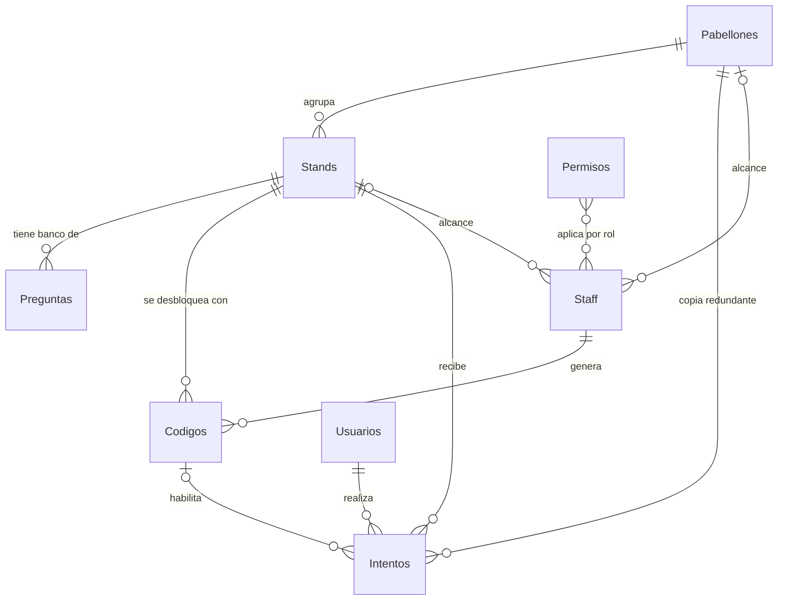

# Modelo de datos

Última actualización: 2026-10-05

Todos los datos viven en un único archivo de Google Sheets con 10 hojas. El ranking no es una hoja: se calcula desde `Intentos`.

## Hojas

| Hoja | Tipo | Para qué |
|---|---|---|
| `Pabellones` | Catálogo | Agrupador de stands |
| `Stands` | Catálogo | Agente dentro de un pabellón; unidad de participación |
| `Preguntas` | Catálogo | Banco de preguntas por stand |
| `Staff` | Catálogo | Líderes y administradores |
| `Permisos` | Catálogo | Vistas de la app disponibles para cada rol |
| `Config` | Catálogo | Parámetros de la aplicación |
| `Premios` | Catálogo | Premios que se muestran en la sala de espera (opcional) |
| `Usuarios` | Transaccional | Personas que usan la app y compiten en el ranking |
| `Codigos` | Transaccional | Códigos temporales por stand |
| `Intentos` | Transaccional | Participaciones y puntaje |

Las hojas de catálogo casi no cambian durante la feria y se editan desde el panel admin. Las transaccionales las escribe la aplicación mientras la feria está en curso.

## Relación entre las tablas

`Config` no se relaciona con ninguna hoja: es una lista de clave y valor.

### Detalle de cada relación

| Desde | Campo | Hacia | Cardinalidad | Obligatoria | Nota |
|---|---|---|---|---|---|
| `Stands` | `pabellon_id` | `Pabellones.pabellon_id` | Muchos a uno | Sí | Todo stand pertenece a un pabellón |
| `Preguntas` | `stand_id` | `Stands.stand_id` | Muchos a uno | Sí | Cada pregunta es de un solo stand |
| `Codigos` | `stand_id` | `Stands.stand_id` | Muchos a uno | Sí | Un código desbloquea un solo stand |
| `Codigos` | `generado_por` | `Staff.email` | Muchos a uno | Sí | Quién generó el código |
| `Intentos` | `email` | `Usuarios.email` | Muchos a uno | Sí | Quién responde |
| `Intentos` | `stand_id` | `Stands.stand_id` | Muchos a uno | Sí | Qué stand responde |
| `Intentos` | `pabellon_id` | `Pabellones.pabellon_id` | Muchos a uno | Sí | Copia del pabellón del stand; evita cruzar tablas en el ranking |
| `Intentos` | `codigo` | `Codigos.codigo` | Muchos a uno | No | Vacío en el quiz de entrada |
| `Intentos` | `preguntas_json` | `Preguntas.pregunta_id` | Muchos a muchos | Sí | Lista de IDs sorteados, guardada como JSON |
| `Staff` | `pabellon_id` | `Pabellones.pabellon_id` | Muchos a uno | No | Vacío para `ADMIN` |
| `Staff` | `stand_id` | `Stands.stand_id` | Muchos a uno | No | Vacío = todos los stands de su pabellón |
| `Staff` | `rol` | `Permisos.rol` | Muchos a muchos | Sí | Se une por el texto del rol; un rol tiene varias filas en `Permisos` |

### Reglas de integridad

Google Sheets no valida relaciones; estas reglas las hace cumplir el Apps Script.

1. **Un intento por persona y stand:** la combinación `email` + `stand_id` es única en `Intentos`.
2. **Las claves no se reutilizan ni se derivan del nombre:** son correlativos generados (`PAB-001`, `STD-001`, `PRG-001`, `INT-0001`). Renombrar un stand no rompe sus preguntas ni sus intentos.
3. **Baja lógica:** las filas con historial no se borran, se desactivan con `activo = FALSE`. Un código vencido pasa a `estado = EXPIRADO`, no se elimina.
4. **Coherencia de `pabellon_id` en `Intentos`:** siempre es el pabellón del `stand_id` de esa misma fila, copiado al crearla.
5. **Coherencia del código:** el `codigo` de un intento debe pertenecer al mismo `stand_id` del intento.
6. **Preguntas del intento:** todos los IDs de `preguntas_json` deben ser preguntas activas del `stand_id` del intento al momento de crearlo.
7. **Un código activo por stand:** al generar uno nuevo, el anterior de ese stand pasa a `ANULADO`.
8. **Banco suficiente:** un stand necesita al menos `num_preguntas` preguntas activas para poder abrir su quiz.
9. **El quiz de entrada es un stand más:** `STD-000` en el pabellón `PAB-000`, con `requiere_codigo = FALSE`. No se muestra en la lista de pabellones a visitar.
10. **Un permiso por rol y vista:** la combinación `rol` + `vista` es única en `Permisos`.
11. **Roles válidos:** todo `rol` usado en `Staff` debe tener al menos una fila activa en `Permisos`. `USUARIO` no se escribe en `Staff`: es el rol de quien no aparece ahí.
12. **Los permisos no reemplazan la validación del servidor:** `Permisos` decide qué vistas se muestran, pero cada función del Apps Script vuelve a comprobar el rol antes de ejecutar.

## Campos por hoja

### `Pabellones`

| Campo | Tipo | Ejemplo | Nota |
|---|---|---|---|
| `pabellon_id` | Texto | `PAB-001` | Clave |
| `nombre` | Texto | Backend | Visible para el usuario |
| `descripcion` | Texto | | Opcional |
| `orden` | Número | 1 | Orden en la app |
| `activo` | Booleano | TRUE | Baja lógica |
| `creado_en` | Fecha/hora | | |

### `Stands`

| Campo | Tipo | Ejemplo | Nota |
|---|---|---|---|
| `stand_id` | Texto | `STD-001` | Clave |
| `pabellon_id` | Texto | `PAB-001` | Referencia a `Pabellones` |
| `nombre` | Texto | APX | Visible para el usuario |
| `descripcion` | Texto | | Opcional |
| `requiere_codigo` | Booleano | TRUE | FALSE solo en el quiz de entrada |
| `num_preguntas` | Número | 4 | 5 en el quiz de entrada |
| `orden` | Número | 1 | Orden dentro del pabellón |
| `activo` | Booleano | TRUE | Baja lógica |
| `creado_en` | Fecha/hora | | |

### `Preguntas`

| Campo | Tipo | Ejemplo | Nota |
|---|---|---|---|
| `pregunta_id` | Texto | `PRG-001` | Clave |
| `stand_id` | Texto | `STD-001` | Referencia a `Stands` |
| `texto` | Texto | | Enunciado |
| `opcion_a` | Texto | | |
| `opcion_b` | Texto | | |
| `opcion_c` | Texto | | |
| `opcion_d` | Texto | | |
| `correcta` | Texto | B | A–D; nunca se envía al celular |
| `puntos` | Número | 10 | Valor si acierta |
| `activo` | Booleano | TRUE | Baja lógica |
| `creado_en` | Fecha/hora | | |

### `Staff`

| Campo | Tipo | Ejemplo | Nota |
|---|---|---|---|
| `email` | Texto | | Clave |
| `nombre` | Texto | | |
| `rol` | Texto | `LIDER` | `LIDER` o `ADMIN`; sus vistas se definen en `Permisos` |
| `pabellon_id` | Texto | `PAB-001` | Vacío para `ADMIN` |
| `stand_id` | Texto | `STD-001` | Vacío = todos los stands de su pabellón |
| `activo` | Booleano | TRUE | Baja lógica |

El primer `ADMIN` se escribe a mano en el Sheet; los siguientes se crean desde el panel. Quien no aparece en `Staff`, o aparece con `activo = FALSE`, es un usuario normal.

### `Permisos`

Una fila por cada par de rol y vista. Dar o quitar una vista a un rol es agregar o desactivar una fila.

| Campo | Tipo | Ejemplo | Nota |
|---|---|---|---|
| `rol` | Texto | `LIDER` | `USUARIO`, `LIDER`, `ADMIN` o un rol nuevo |
| `vista` | Texto | `GENERAR_CODIGO` | Nombre exacto de una vista que existe en el código |
| `activo` | Booleano | TRUE | Baja lógica |

Vistas disponibles:

| `vista` | Qué muestra |
|---|---|
| `MAPA` | Inicio del usuario: puntaje, puesto y mapa de pabellones con sus stands |
| `QUIZ` | Ingresar el código de un stand, responder las preguntas y ver el resultado |
| `RANKING` | Posición propia y tabla de puntajes en el celular |
| `GENERAR_CODIGO` | Generar el código temporal de un stand |
| `PANEL_ADMIN` | Crear y editar pabellones, stands, preguntas, staff, permisos y configuración |
| `BOARD` | Ranking para la pantalla gigante |

Filas iniciales:

| `rol` | `vista` | `activo` |
|---|---|---|
| USUARIO | MAPA | TRUE |
| USUARIO | QUIZ | TRUE |
| USUARIO | RANKING | TRUE |
| LIDER | GENERAR_CODIGO | TRUE |
| LIDER | RANKING | TRUE |
| ADMIN | MAPA | TRUE |
| ADMIN | QUIZ | TRUE |
| ADMIN | RANKING | TRUE |
| ADMIN | GENERAR_CODIGO | TRUE |
| ADMIN | PANEL_ADMIN | TRUE |
| ADMIN | BOARD | TRUE |

`MAPA`, `QUIZ` y `RANKING` son las tres vistas del usuario y ya tienen prototipo; su comportamiento está en [../reglas/ux-ui.md](../reglas/ux-ui.md). `QUIZ` se abre desde `MAPA`, así que un rol con `QUIZ` necesita también `MAPA`.

El `LIDER` no participa: no tiene `MAPA` ni `QUIZ`, por lo que no responde quizzes ni suma puntos. Su pantalla de inicio es `GENERAR_CODIGO`.

Una vista escrita en la hoja que no exista en el código no tiene efecto. Agregar una vista nueva requiere programarla primero.

### `Usuarios`

| Campo | Tipo | Ejemplo | Nota |
|---|---|---|---|
| `email` | Texto | | Clave |
| `nombre` | Texto | | Se muestra en el ranking |
| `registrado_en` | Fecha/hora | | Primer ingreso a la app |

### `Codigos`

| Campo | Tipo | Ejemplo | Nota |
|---|---|---|---|
| `codigo` | Texto | `K7M2` | Clave, 4–6 caracteres |
| `stand_id` | Texto | `STD-001` | Stand que desbloquea |
| `generado_por` | Texto | | Email del líder, referencia a `Staff` |
| `creado_en` | Fecha/hora | | |
| `expira_en` | Fecha/hora | | `creado_en` + `minutos_vigencia_codigo` |
| `estado` | Texto | `ACTIVO` | `ACTIVO`, `EXPIRADO`, `ANULADO` |

### `Intentos`

Una fila por persona y stand. Se crea al ingresar el código y se completa al enviar las respuestas.

| Campo | Se llena | Tipo | Ejemplo | Nota |
|---|---|---|---|---|
| `intento_id` | Al iniciar | Texto | `INT-0001` | Clave |
| `email` | Al iniciar | Texto | | Referencia a `Usuarios` |
| `stand_id` | Al iniciar | Texto | `STD-001` | Referencia a `Stands` |
| `pabellon_id` | Al iniciar | Texto | `PAB-001` | Copia redundante |
| `codigo` | Al iniciar | Texto | `K7M2` | Vacío en el quiz de entrada |
| `preguntas_json` | Al iniciar | Texto | `["PRG-012","PRG-015"]` | IDs de las preguntas sorteadas |
| `iniciado_en` | Al iniciar | Fecha/hora | | Hora del servidor |
| `vence_en` | Al iniciar | Fecha/hora | | `iniciado_en` + `minutos_para_responder` |
| `estado` | Ambos | Texto | `EN_CURSO` | `EN_CURSO`, `COMPLETADO`, `VENCIDO` |
| `respuestas_json` | Al enviar | Texto | | Pregunta, opción elegida, si acertó |
| `correctas` | Al enviar | Número | 3 | |
| `puntaje` | Al enviar | Número | 30 | Lo que suma al ranking |
| `completado_en` | Al enviar | Fecha/hora | | Sirve para desempate |

Solo los intentos en `COMPLETADO` suman al ranking. Un intento `EN_CURSO` cuyo `vence_en` ya pasó se trata como vencido aunque el texto del estado no haya cambiado.

### `Config`

| Campo | Tipo | Nota |
|---|---|---|
| `clave` | Texto | Clave |
| `valor` | Texto | |
| `descripcion` | Texto | Para quien edite desde el panel |

Filas iniciales:

| `clave` | `valor` |
|---|---|
| `minutos_vigencia_codigo` | 5 |
| `minutos_para_responder` | 5 |
| `puntos_por_defecto` | 10 |
| `segundos_refresco_board` | 15 |
| `segundos_cache_catalogo` | 60 |
| `espera_activa` | FALSE |
| `fecha_feria` | (vacío) |
| `lugar_feria` | (vacío) |
| `espera_mensaje` | (vacío) |

Claves de la sala de espera:

- `espera_activa`: con TRUE, quien tiene rol `USUARIO` ve solo la sala de espera. Con FALSE la sala no existe para nadie.
- `fecha_feria`: fecha y hora del evento, para la cuenta regresiva. Puede ser una celda con formato de fecha y hora, o texto como `2026-10-22 09:00` o `22/10/2026 09:00`. Vacía, la sala muestra "Muy pronto" sin cuenta.
- `lugar_feria` y `espera_mensaje`: textos opcionales que aparecen bajo la fecha.

### `Premios`

Hoja opcional. Si no existe o está vacía, la sala de espera no muestra la sección de premios.

| Campo | Tipo | Ejemplo | Nota |
|---|---|---|---|
| `orden` | Número | 1 | Orden en que se listan |
| `titulo` | Texto | Primer puesto | Visible para el usuario |
| `descripcion` | Texto | Audífonos inalámbricos | Opcional |
| `activo` | Booleano | TRUE | Baja lógica |

## Sala de espera y usuarios de prueba

Mientras `espera_activa` está en TRUE:

| Quién | Qué ve |
|---|---|
| Persona con rol `USUARIO`: no está en `Staff`, o está ahí con ese rol | Solo la sala de espera. El servidor rechaza cualquier otra acción |
| Persona en `Staff` con cualquier otro rol (`LIDER`, `PRUEBA`, etc.) | La app normal, según las vistas de su rol en `Permisos` |
| `ADMIN` | La app normal y además una pestaña "Espera" para ver lo mismo que los usuarios |

Un usuario de prueba es una fila en `Staff` con rol `PRUEBA`, y tres filas en `Permisos` que le dan a ese rol `MAPA`, `QUIZ` y `RANKING`. Juega igual que un usuario normal y aparece en el ranking, así que antes del evento hay que reiniciar los datos.

La sala de espera no registra a nadie en `Usuarios` ni escribe en ninguna hoja. La vista `ESPERA` no va en `Permisos`: la decide `espera_activa`.
| `feria_abierta` | TRUE |

## Ranking (vista calculada)

No es una hoja. El script lo calcula desde `Intentos` y lo guarda en caché unos segundos:

- **Puntaje total:** suma de `puntaje` de los intentos `COMPLETADO` de cada `email`.
- **Stands visitados:** cantidad de intentos `COMPLETADO`.
- **Pabellones visitados:** cantidad de `pabellon_id` distintos.
- **Nombre:** se toma de `Usuarios`.

## Reinicio de datos

El `PANEL_ADMIN` permite dejar la app como al inicio. Solo afecta a las hojas transaccionales; las de catálogo nunca se tocan.

| Hoja | Al reiniciar | Motivo |
|---|---|---|
| `Intentos` | Se borra siempre | Es la fuente del puntaje y del ranking |
| `Codigos` | Se borra siempre | Los códigos solo sirven para la sesión en curso |
| `Usuarios` | Se borra siempre | Los usuarios se vuelven a registrar solos al entrar |
| `Pabellones`, `Stands`, `Preguntas`, `Staff`, `Permisos`, `Config` | Se conservan | Son la configuración de la feria |

Reglas del reinicio:

1. **Solo `ADMIN`:** el servidor comprueba el rol antes de ejecutar.
2. **Se borran las filas, no los encabezados.**
3. **Copia previa:** antes de borrar, las hojas afectadas se copian dentro del mismo archivo con el nombre `respaldo_AAAA-MM-DD_HHMM`.
4. **Bajo bloqueo:** se ejecuta con `LockService` para que no entren intentos nuevos a mitad del borrado.
5. **Caché:** se limpia la caché del ranking para que el board no siga mostrando puntajes viejos.
6. **Correlativos:** `intento_id` vuelve a empezar desde `INT-0001`.
7. **Confirmación:** la interfaz exige escribir `REINICIAR` y muestra cuántas filas se van a borrar.

## Catálogo inicial

| Pabellón | Stands |
|---|---|
| `PAB-000` General | `STD-000` Quiz de entrada |
| `PAB-001` Backend | `STD-001` APX · `STD-002` ASO / APIs · `STD-003` LRA / LRBA |
| `PAB-002` Frontend | `STD-004` Cells · `STD-005` Glomo · `STD-006` Emailing |
| `PAB-003` Quality | `STD-007` Testing · `STD-008` QE · `STD-009` Code Review |
| `PAB-004` Seguridad | `STD-010` SAST · `STD-011` Security · `STD-012` Gobierno · `STD-013` Quality |
| `PAB-005` Data | `STD-014` ADA · `STD-015` Data & Analytics · `STD-016` Gobierno de Datos |
| `PAB-006` Host | `STD-017` Synapse · `STD-018` Katalyst · `STD-019` Control-M |

Los stands "Otros" del plano no se contemplan por ahora. Se agregan como filas nuevas cuando se definan.

## Pendiente de confirmar

Estas decisiones están asumidas en el modelo pero no fueron confirmadas:

1. **Dos tiempos de expiración:** 5 minutos para ingresar el código desde que el líder lo genera, y 5 minutos por persona para responder desde que lo ingresa.
2. **Sin reintento:** si a alguien se le vence el tiempo, ese stand queda en 0 y no puede repetirlo.
3. **Desempate:** gana quien alcanzó primero el puntaje, según `completado_en`.
4. **Reinicio:** la copia de respaldo antes de borrar es una propuesta.
5. **Vistas por rol:** las filas iniciales de `Permisos` son una propuesta; en particular, que solo `ADMIN` abra el `BOARD`.
6. **Valores de `Config`:** 10 puntos por pregunta y 15 segundos de refresco del board son valores propuestos.
